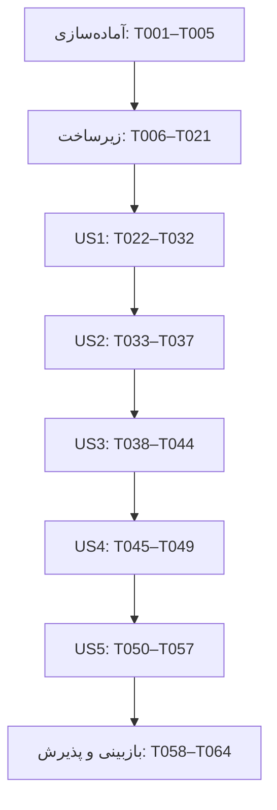

# وظایف اجرایی: نسخهٔ اولیهٔ ChangeFlow

**تاریخ تولید**: 2026-11-16

**ورودی‌ها**: [قانون اساسی](../../.specify/memory/constitution.md)، [مشخصات](spec.md)، [Plan](plan.md)،
[Research](research.md)، [مدل داده](data-model.md)، [قرارداد HTTP](contracts/http-api.md)،
[OpenAPI](contracts/openapi.json)، [راهنمای اعتبارسنجی](quickstart.md) و [ماتریس پذیرش](validation.md).

**وضعیت**: فاز اول و فاز دوم در T001 تا T021 با شواهد واقعی تکمیل شدند؛
[گزارش آماده‌سازی](evidence/setup.md) و [گزارش زیرساخت](evidence/foundation.md) نتایج اجرا را ثبت می‌کنند.
T022 تا T064 انجام‌نشده‌اند؛ آغاز فاز سوم و هر فاز بعدی به تأیید صریح کاربر وابسته است.

**آزمون‌ها**: کاربر و قانون اساسی و Specification آزمون خودکار قواعد حیاتی، امنیت و Concurrency را الزام کرده‌اند؛
به همین دلیل Task آزمون برای هر داستان و زیرساخت وجود دارد.

**سازمان‌دهی**: پنج داستان عیناً US1 تا US5 مشخصات‌اند و همگی P1 هستند. MVP پذیرفته‌شدنی شامل هر پنج داستان است؛
US1 به‌تنهایی فقط نخستین برش مستقل برای نمایش و بررسی است.

## قالب و معنای نشانه‌ها

- هر Task دارای چک‌باکس وضعیت، شناسهٔ یکتا، مسیر فایل و پیش‌نیاز مستقیم است.
- [P] یعنی پس از تکمیل همهٔ پیش‌نیازهای آن ردیف، می‌توان آن را با Task آمادهٔ دیگری که فایل مشترک ندارد انجام داد.
- [US1] تا [US5] فقط در مراحل داستان‌ها می‌آیند؛ آماده‌سازی، زیرساخت و مرحلهٔ نهایی برچسب داستان ندارند.
- پیش‌نیازهای مستقیم در هر ردیف نوشته شده‌اند؛ وابستگی‌های غیرمستقیم از همان زنجیره به‌دست می‌آیند.
- مسیرها نسبت به ریشهٔ مخزن هستند. مالکیت فایل مشترک مثل src/app.module.ts، package.json و کاربردهای ویرایش/Submit
  با ترتیب وابستگی‌ها کنترل شده است؛ یکسان‌بودن اولویت به معنی مجازبودن ویرایش هم‌زمان این فایل‌ها نیست.
- آزمون‌ها پیش از تکمیل رفتار نوشته شوند. در Task پیاده‌سازی، پس از اسکلت importپذیر و پیش از منطق جدید،
  شکست رفتاری آزمون مرتبط ثبت شود؛ خطای نصب یا import جای شکست assertion نیست. آزمون بخش موجود می‌تواند سبز بماند.
- شواهد داخل evidence/ فقط بر مبنای فرمان واقعی ساخته می‌شوند؛ هیچ ردیفی صرفاً با استناد به این فهرست تأیید نمی‌شود.

## قرارداد مسیرها

یک پروژهٔ Nest در src/ با http/، application/، domain/ و infrastructure/؛ آزمون‌ها در test/unit/،
test/integration/ و test/fixtures/؛ SQLهای Migration در migrations/ و ابزارهای محلی در tools/ قرار می‌گیرند.
ORM، Login، مدیریت حساب، Endpoint نقش، حذف، لغو، Idempotency، Frontend، AI، RAG، MCP و Multi-Agent
به محصول افزوده نمی‌شوند. ابزار محلی provision و تغییر نقش فقط برای Development/Test و آزمون ترتیب تراکنش است.

## مرحلهٔ ۱: آماده‌سازی مشترک

**هدف**: اسکلت و ابزارهای مصوب، پیکربندی محلی و امکان آزمون واقعی Native Driver؛ پیش‌نیاز مراحل بعدی است.

- [X] T001 راه‌اندازی اسکلت تک‌برنامهٔ NestJS 12 با TypeScript 6، Node.js 24 LTS با حداقل 24.15، CommonJS، Express و وابستگی‌های مصوب؛ نسخه‌های سازگار را در lockfile تثبیت و ساختار src/ و test/ و migrations/ و tools/ را ایجاد کنید؛ هیچ قابلیت خارج از Scope اضافه نشود. مسیرها: `package.json`، `package-lock.json`، `tsconfig.json`، `nest-cli.json`، `src/main.ts`، `src/app.module.ts`؛ پیش‌نیاز: ندارد؛ مبنا: Plan/Research و اصول قانون اساسی؛
- [X] T002 [P] پیکربندی Jest 30، @nestjs/testing و Supertest و مجموعه‌های Unit، Integration، Concurrency و Contract؛ تمام نام‌های npm scripts راهنمای quickstart را از ابتدا به مسیرهای معلوم نگاشت و گزارش آزمون را قابل ذخیره کنید. مسیرها: `jest.config.cjs`، `jest.integration.config.cjs`، `jest.concurrency.config.cjs`، `jest.contract.config.cjs`، `package.json`؛ پیش‌نیاز: T001؛ مبنا: Plan/Research و اصول قانون اساسی؛
- [X] T003 [P] تعریف تنظیمات NODE_ENV، PORT، DATABASE_PATH، JWT_ISSUER، JWT_AUDIENCE و JWT_SECRET با خطای پیکربندی صریح؛ کلید واقعی و Database و شواهد حساس را از Git خارج کنید؛ حالت محلی برای production بدون تنظیم مستقل فعال نشود. مسیرها: `src/infrastructure/configuration.ts`، `.env.example`، `.gitignore`؛ پیش‌نیاز: T001؛ مبنا: Plan/Research و اصول قانون اساسی؛
- [X] T004 [P] ایجاد ابزار dev:init برای کلید تصادفی محلی خارج از مخزن و تنظیم issuer برابر changeflow-dev و audience برابر changeflow-api؛ کلید موجود خودکار بازنویسی و در خروجی عمومی چاپ نشود. مسیرها: `tools/dev-init.ts`؛ پیش‌نیاز: T003؛ ردیابی: FR-012، AC-116؛
- [X] T005 بررسی واقعی نصب وابستگی‌های قفل‌شده و بارگذاری Native Driver better-sqlite3 با فایل موقت؛ نسخهٔ Node/npm/Native SQLite و خطای احتمالی نصب را ثبت کنید؛ موفقیت فرضی و نصب ORM جایگزین مجاز نیست. مسیرها: `test/integration/native-driver.spec.ts`، `specs/001-change-request-management/evidence/setup.md`؛ پیش‌نیاز: T002، T003، T004؛ مبنا: Plan/Research و اصول قانون اساسی؛

**دروازه**: T001 تا T005 تکمیل و نصب/بارگذاری Driver با شواهد واقعی قابل بررسی باشد.

## مرحلهٔ ۲: زیرساخت پایه و پیش‌نیازهای مسدودکننده

**هدف**: Migration، مدل‌های مشترک، Authentication، سیاست Authorization، اتصال و مرز تراکنش و پیکربندی HTTP/آزمون. آغاز کار داستان‌ها به تکمیل این مرحله وابسته است. تضمین پایهٔ Concurrency در همین مرحله ساخته می‌شود؛ US5 اثبات و تثبیت آن را انجام می‌دهد.

- [X] T006 [P] تعریف مدل User و قیود مدل داده عیناً: id «شناسهٔ یکتای UUID، تولید یا provision توسط سامانه»، issuer «متن غیرخالی از صادرکنندهٔ معتبر»، subject «متن غیرخالی، منطبق با sub توکن معتبر» و هر دو isRequester و isReviewer «مقدار منطقی، پیش‌فرض غیرفعال»؛ زوج (issuer, subject) یکتا و ردیف مالک پایدار باشد؛ مدل وابستگی Nest/SQLite نداشته باشد. مسیرها: `src/domain/user.ts`؛ پیش‌نیاز: T005؛ ردیابی: FR-003، FR-012، FR-019؛
- [X] T007 [P] تعریف مدل مشترک ChangeRequest با قیود عیناً: id «UUID یکتا و تغییرناپذیر»، title «متن سادهٔ Unicode؛ ۱ تا ۲۰۰ scalar پس از trim»، description «متن سادهٔ Unicode؛ ۱ تا ۵۰۰۰ scalar پس از trim»، reason «متن سادهٔ Unicode؛ ۱ تا ۲۰۰۰ scalar پس از trim»، requesterId «ارجاع اجباری به users.id، تغییرناپذیر»، status «یکی از Draft، PendingReview، ChangesRequested، Approved» و version «token یکتای UUID و غیرقابل انتخاب توسط مشتری»؛ هر تغییر موفق نسخهٔ تازه دارد و فیلد کسب‌وکار اضافی ساخته نشود. مسیرها: `src/domain/change-request.ts`؛ پیش‌نیاز: T005؛ ردیابی: FR-002، FR-003، FR-018، FR-022، FR-026؛
- [X] T008 [P] تعریف نتایج/خطاهای مستقل از HTTP برای شش دستهٔ مصوب، ورودی با field و reason، وضعیت نامعتبر، نسخهٔ غایب/نامعتبر/قدیمی و شکست زیرساخت؛ اطلاعات پنهان و JWT در خطا ذخیره یا افشا نشوند. مسیرها: `src/domain/errors.ts`؛ پیش‌نیاز: T005؛ ردیابی: FR-016، FR-017، FR-027؛
- [X] T009 [P] ساخت Migration ترتیبی برای users، change_requests و schema_migrations مطابق تمام قیود نقل‌شده در T006 و T007؛ PK، UNIQUE زوج هویت، FK اجباری بدون حذف زنجیره‌ای، NOT NULL، وضعیت مجاز و پرچم‌های منطقی با پیش‌فرض غیرفعال را اعمال کنید؛ runner شماره و checksum را تراکنشی ثبت کند، پیش از ترافیک اجرا شود و reset یا synchronize خودکار نداشته باشد. مسیرها: `migrations/001-initial-schema.sql`، `src/infrastructure/sqlite/migration-runner.ts`، `tools/migrate.ts`؛ پیش‌نیاز: T005؛ ردیابی: FR-002، FR-003، FR-016، FR-018؛
- [X] T010 ساخت Provider اتصال SQLite محلی با foreign_keys فعال برای هر اتصال، مهلت انتظار ۱۰۰۰ میلی‌ثانیه و بستن اتصال در shutdown؛ WAL خودکار و فایل شبکه‌ای فعال نشوند؛ اشغال Database با خطای نسخه یکی تلقی نشود. مسیرها: `src/infrastructure/sqlite/sqlite-database.ts`؛ پیش‌نیاز: T009؛ ردیابی: FR-014، FR-015، FR-016؛
- [X] T011 پیاده‌سازی مرز واحد کار .immediate با callback کاملاً همگام؛ BEGIN IMMEDIATE پیش از خواندن مجوز/درخواست، Commit فقط پس از موفقیت و Rollback در خطا؛ await، شبکه، retry کاربردی و تکرار پس از Commit نامعلوم در callback نباشد؛ API خواندن snapshot سازگار نیز فراهم شود. مسیرها: `src/infrastructure/sqlite/sqlite-unit-of-work.ts`؛ پیش‌نیاز: T008، T010؛ ردیابی: FR-012، FR-014، FR-015، FR-016، FR-024، AC-505، AC-506، AC-507؛
- [X] T012 [P] تعریف سیاست‌های مستقل از HTTP برای مالکیت، نقش فعلی Requester و Reviewer، مشاهدهٔ مالک در چهار وضعیت، مشاهدهٔ درخواست دیگران فقط برای Reviewer در PendingReview و اعتبار زمانی هویت هنگام اعمال نهایی و منع هر دو تصمیم روی درخواست خود؛ نقش‌های دوگانه استثنا نیستند و منطق Guard جداگانه تکرار نشود. مسیرها: `src/domain/authorization-policy.ts`؛ پیش‌نیاز: T006، T007، T008؛ ردیابی: FR-004، FR-008، FR-009، FR-012، FR-019، FR-023؛
- [X] T013 ساخت Store اختصاصی مجوز با Prepared SQL و سرویس تغییر مجوز داخلی بر اساس (issuer, subject)؛ نقش جاری از users خوانده و تغییر نقش از همان واحد کار IMMEDIATE عبور کند؛ حذف ردیف مالک یا اتکا به role claim/Cache مجاز نیست و Endpoint مدیریت نقش ساخته نشود؛ طبق D-08، نبود نگاشت (issuer, subject) باید نتیجه‌ای صریح و متمایز از شکست Database باشد؛ هیچ کاربر یا نقشی خودکار ساخته نشود و role claim مجوز ایجاد نکند. مسیرها: `src/infrastructure/sqlite/sqlite-user-store.ts`، `src/application/change-user-permissions.ts`؛ پیش‌نیاز: T006، T010، T011؛ ردیابی: FR-012، FR-019، FR-024، AC-306، AC-506، AC-507؛
- [X] T014 [P] ایجاد اعتبارسنج JWT و Guard هویت با @nestjs/jwt؛ HS256، امضا، iss، aud، exp و sub صریح بررسی شوند؛ خروجی فقط هویت قابل اتکا باشد، role claim مرجع نقش نباشد و decode جای verify ننشیند؛ Login/Refresh Token یا Header هویت قابل انتخاب مشتری اضافه نشود. مسیرها: `src/infrastructure/authentication/jwt-identity.ts`، `src/http/guards/authentication.guard.ts`؛ پیش‌نیاز: T003، T006، T008؛ ردیابی: FR-012، AC-104، AC-116، AC-204؛
- [X] T015 [P] ساخت Filter/نگاشت پاسخ فارسی مطابق قرارداد: 400،401،403،404،409،412،413،428 و 500/503 فنی؛ errors برای ورودی، WWW-Authenticate برای 401 و no-store؛ پاسخ 404 دقیقاً یکسان و بدون errors/ETag/Location و خطاهای داخلی یا کلید باشد؛ طبق D-07، پاسخ فنی 413 با code برابر PAYLOAD_TOO_LARGE، دستهٔ «خطای فنی»، پیام «حجم بدنهٔ درخواست بیش از حد مجاز است» و Cache-Control: no-store ارائه شود؛ پاسخ فاقد errors، ETag، Location و اطلاعات منبع باشد. مسیرها: `src/http/filters/api-error.filter.ts`؛ پیش‌نیاز: T008؛ ردیابی: FR-017، FR-023، FR-027، AC-115، AC-116، AC-313، AC-316، AC-508؛
- [X] T016 [P] تعریف codec نسخه برای ETag قوی با شکل "cf-{id}-{version}" و یک If-Match؛ نسخهٔ UUID فنی، wildcard/چندمقداری/ضعیف نامعتبر، نبود نسخه 428 و mismatch برابر 412 باشد؛ تجزیهٔ header نباید پیش از visibility خطای اختصاصی بدهد. مسیرها: `src/http/etag.ts`؛ پیش‌نیاز: T007، T008؛ ردیابی: FR-014، FR-017؛
- [X] T017 ساخت بخش خواندن Store اختصاصی درخواست با Prepared SQL در Infrastructure؛ خواندن درخواست و نقش جاری باید روی همان اتصال و در snapshot سازگار T011 انجام شود و SQL وارد Application یا Controller نشود؛ سپس Query/Guard اولیهٔ visibility از همین قابلیت و سیاست مشترک T012 استفاده کند؛ برای id نامعتبر، ناموجود یا غیرقابل‌مشاهده پاسخ یکسان بدهید؛ مجوز نهایی عملیات به Application داخل تراکنش واگذار شود؛ طبق D-08، JWT معتبر بدون نگاشت محلی نباید درخواست قابل مشاهده‌ای داشته باشد و عملیات وابسته به شناسه باید همان 404 عمومی مصوب را دریافت کنند. مسیرها: `src/infrastructure/sqlite/sqlite-change-request-store.ts`، `src/application/request-visibility.ts`، `src/http/guards/request-visibility.guard.ts`؛ پیش‌نیاز: T007، T010، T011، T012، T013، T014، T015؛ ردیابی: FR-019، FR-023، AC-106، AC-308، AC-309، AC-310، AC-313، AC-316؛
- [X] T018 تکمیل bootstrap مشترک HTTP برای تقدم هویت و visibility بر parsing/DTO/If-Match؛ بدنهٔ خام محدود و parsing پس از Guardها، رد خصوصیت اضافی بدون whitelist حذف‌کننده و بدون تبدیل نوع؛ ورودی خام/خطای HTTP را طوری نگه دارید که Application بتواند پیش از پاسخ اختصاصی، مجوز و وضعیت جاری را بررسی کند؛ Filter و no-store را نصب کنید؛ طبق D-07، سقف دریافت بدنهٔ خام باید ۱۳۱۰۷۲ بایت باشد؛ عبور از سقف هنگام دریافت و پیش از parsing، Authentication و visibility با 413 عمومی رد شود و هیچ داده‌ای تغییر نکند؛ اندازهٔ دقیق سقف باید از کنترل حجم عبور کند و سایر اعتبارسنجی‌ها مستقل‌اند؛ برای بدنهٔ در محدوده، ترتیب عادی بررسی‌ها حفظ شود. مسیرها: `src/main.ts`، `src/http/configure-http.ts`، `src/http/pipes/parse-json-body.pipe.ts`، `src/app.module.ts`؛ پیش‌نیاز: T014، T015، T017؛ ردیابی: FR-012، FR-023، FR-025، FR-027، AC-313، AC-316؛
- [X] T019 [P] ساخت fixture مجزا برای فایل SQLite موقت با Migration واقعی، کاربران requester-a/reviewer-b/dual-c/reviewer-d و درخواست آماده در هر چهار وضعیت؛ Nest test factory باید bootstrap واقعی و JWT امضاشده داشته باشد و اتصال/فایل هر آزمون را پاک‌سازی محدود کند؛ ایجاد fixture نیازمند Endpoint داستان دیگر نباشد. مسیرها: `test/fixtures/database-fixture.ts`، `test/fixtures/identity-fixture.ts`، `test/fixtures/create-test-app.ts`؛ پیش‌نیاز: T002، T009، T010، T013، T014، T018؛ مبنا: Plan/Research و اصول قانون اساسی؛
- [X] T020 [P] ساخت ابزارهای dev:seed، dev:token و dev:permissions فقط برای Development/Test؛ seed تکرارپذیر بدون حذف درخواست، توکن کوتاه‌عمر برای sub نمونه و تغییر مجوز از سرویس T013؛ endpoint عمومی یا JWT ثابت داخل مخزن ایجاد نشود. مسیرها: `tools/dev-seed.ts`، `tools/dev-token.ts`، `tools/dev-permissions.ts`؛ پیش‌نیاز: T004، T009، T011، T013، T014؛ ردیابی: FR-012، FR-024، AC-306، AC-506، AC-507؛
- [X] T021 آزمون و ثبت آمادگی زیرساخت: Migration اولیه/تکراری/checksum/عدم reset و FK، JWT با امضا/issuer/audience/انقضا/sub نامعتبر، سیاست نقش و منع تصمیم روی درخواست خود، ETag و خطاهای فارسی؛ خواندن جاری مجوز و rollback واحد کار بررسی شوند؛ با fixture آمادهٔ T019، خواندن واقعی درخواست و visibility مالک در چهار وضعیت، Reviewer برای درخواست دیگران فقط در PendingReview و پاسخ یکسان برای درخواست ناموجود و پنهان بررسی شوند؛ طبق D-08، با JWT معتبر برای subject ثبت‌نشده، حتی دارای role claim، نبود مجوز محلی، نتیجهٔ صریح نگاشت ناموجود و عدم ساخت کاربر یا نقش بررسی شود؛ بررسی HTTP ایجاد و عملیات وابسته به شناسه در T061 انجام می‌شود؛ فقط پس از نتیجهٔ واقعی این دروازه به داستان‌ها بروید. مسیرها: `test/integration/foundation.spec.ts`، `test/unit/authorization-policy.spec.ts`، `specs/001-change-request-management/evidence/foundation.md`؛ پیش‌نیاز: T006، T007، T008، T009، T010، T011، T012، T013، T014، T015، T016، T017، T018، T019، T020؛ ردیابی: FR-008، FR-009، FR-012، FR-014، FR-016، FR-019، FR-023، FR-024، FR-027، AC-104، AC-106، AC-116، AC-306، AC-308، AC-309، AC-310، AC-313، AC-316؛

**دروازه**: T006 تا T021 تکمیل شوند. آماده‌بودن این زیرساخت به معنی پیاده‌سازی Endpointهای داستان‌ها نیست.

## مرحلهٔ ۳: داستان ۱ ـ ایجاد و ویرایش پیش‌نویس (اولویت: P1)

**هدف**: Requester بتواند Draft ایجاد و پیش‌نویس خود را ویرایش کند و مالک درخواست خودش را مشاهده کند.

**ارزیابی مستقل**: با کاربران و درخواست‌های آمادهٔ چهار وضعیت، POST/GET/PUT، مالکیت و ورودی را بدون اجرای Submit یا Review بسنجید. معیار این داستان AC-101 تا AC-116 است.

### آزمون‌های داستان ۱

- [ ] T022 [P] [US1] نوشتن آزمون قرارداد POST/GET/PUT پیش از قابلیت: 201 با Location/ETag، نمایش فقط شش فیلد، 200 و نسخهٔ تازه، 400 با نام فیلد و 401 فارسی؛ متن ساده، no-store و منع فیلدهای سامانه نیز بررسی شوند؛ برای هر سه فیلد، مقدار دقیقاً در حداکثر مجاز همراه فاصلهٔ بیرونی باید پذیرفته و trim‌شده ثبت شود، یک scalar بیشتر پس از trim و مقدار فقط فاصله باید کل عملیات را با خطای فیلد رد کنند و مرز طول با فارسی و ایموجی بر مبنای scalar سنجیده شود. مسیرها: `test/integration/us1-contract.spec.ts`؛ پیش‌نیاز: T021؛ ردیابی: FR-001، FR-002، FR-003، FR-017، FR-018، FR-022، FR-025، FR-026، FR-027، AC-101، AC-104، AC-105، AC-112، AC-113، AC-114، AC-115، AC-116؛
- [ ] T023 [P] [US1] نوشتن آزمون مستقل ورودی برای تمام حداقل‌ها/حداکثرها/یک scalar بیشتر، فقدان/null/فقط فاصله، trim، نیم‌فاصله، ایموجی مرکب و Unicode ناسالم و حفظ HTML/Markdown به‌صورت متن؛ وجود خصوصیت تحت کنترل سامانه حتی با مقدار درست باید رد شود. مسیرها: `test/unit/us1-content.spec.ts`؛ پیش‌نیاز: T021؛ ردیابی: FR-022، FR-025، FR-026، AC-109، AC-110، AC-111، AC-112، AC-113، AC-114؛
- [ ] T024 [P] [US1] نوشتن آزمون HTTP مستقل با fixture برای AC-101 تا AC-116؛ ایجاد Draft و هویت واقعی، ویرایش فقط مالک، مشاهدهٔ مالک در هر چهار وضعیت، دو ایجاد مستقل، نبود حذف و خطای ورودی/هویت پوشش داده شوند؛ نتیجهٔ پذیرش هنوز اجراشده اعلام نشود. مسیرها: `test/integration/us1-http.spec.ts`؛ پیش‌نیاز: T021؛ ردیابی: FR-001، FR-002، FR-003، FR-004، FR-019، FR-020، FR-021، FR-022، FR-025، FR-026، FR-027، AC-101، AC-102، AC-103، AC-104، AC-105، AC-106، AC-107، AC-108، AC-109، AC-110، AC-111، AC-112، AC-113، AC-114، AC-115، AC-116؛
- [ ] T025 [P] [US1] نوشتن آزمون Persistence با SQLite واقعی برای نگاشت تمام فیلدها، id/مالک تغییرناپذیر، درخواست تکراری با id تازه، version تازهٔ ویرایش و update مشروط به نسخهٔ مشتری؛ مدل در حافظه یا mock جای فایل واقعی نباشد. مسیرها: `test/integration/us1-persistence.spec.ts`؛ پیش‌نیاز: T021؛ ردیابی: FR-002، FR-003، FR-014، FR-018، FR-020، AC-101، AC-102، AC-107، AC-501؛
### پیاده‌سازی و یکپارچه‌سازی داستان 1

- [ ] T026 [P] [US1] پیاده‌سازی اعتبارسنج محتوای مستقل از Nest با قیود T007: سه string الزامی، well-formed و trim پیش از شمارش scalar با iterator؛ نیم‌فاصله و متن حفظ و HTML/Markdown تفسیر نشوند؛ requesterId/status و هر خصوصیت ناشناخته حتی با مقدار درست رد شوند؛ قواعد وضعیت در کاربرد ویرایش T030 اعمال شوند. مسیرها: `src/domain/change-request-content.ts`، `src/http/inputs/write-change-request.input.ts`؛ پیش‌نیاز: T022، T023، T024؛ ردیابی: FR-022، FR-025، FR-026، AC-109، AC-110، AC-111، AC-112، AC-113، AC-114، AC-115؛
- [ ] T027 [P] [US1] گسترش Store اختصاصی درخواست آماده‌شده در T017 با Prepared SQL برای insert، جایگزینی محتوای مشروط و انتقال مشروط؛ بخش خواندن موجود دوباره ساخته نشود؛ شرط id و version مشتری و شمار ردیف دقیقاً یک و نسخهٔ UUID تازه حفظ شوند؛ Store بدون قواعد HTTP و بدون SQL در Controller باشد و تغییر مالک نداشته باشد. مسیرها: `src/infrastructure/sqlite/sqlite-change-request-store.ts`؛ پیش‌نیاز: T017، T022، T024، T025؛ ردیابی: FR-002، FR-014، FR-016، FR-018، FR-020، AC-101، AC-102، AC-107، AC-501؛
- [ ] T028 [US1] ساخت کاربرد Create با هویت معتبر، مجوز جاری Requester داخل IMMEDIATE، محتوای معتبر، مالک از User و Draft و version اولیه؛ هر ارسال معتبر مستقل باشد و فیلد محافظت‌شده رد کل عملیات بدهد؛ هیچ خطا رکورد جزئی نسازد. مسیرها: `src/application/create-change-request.ts`؛ پیش‌نیاز: T026، T027؛ ردیابی: FR-001، FR-002، FR-003، FR-012، FR-016، FR-020، FR-025، AC-101، AC-104، AC-105، AC-107، AC-113؛
- [ ] T029 [US1] ساخت کاربرد GET با snapshot سازگار و سیاست مشترک مشاهده؛ مالک در همهٔ وضعیت‌ها و Reviewer برای درخواست دیگران فقط PendingReview؛ منابع ناموجود/پنهان یک نتیجهٔ عمومی بدهند و فقط نمایش مجاز نسخه را برگرداند. مسیرها: `src/application/get-change-request.ts`؛ پیش‌نیاز: T027؛ ردیابی: FR-019، FR-023، AC-106، AC-308، AC-309، AC-310، AC-313؛
- [ ] T030 [US1] ساخت کاربرد ویرایش Draft: مجوز و visibility و مالکیت و وضعیت جاری داخل IMMEDIATE، سپس ورودی و نسخهٔ مشتری؛ فقط محتوا و version تغییر کنند و حالت PendingReview/Approved رد شود؛ خطای نسخه بازنویسی یا retry بی‌صدا نداشته باشد. مسیرها: `src/application/update-change-request.ts`؛ پیش‌نیاز: T026، T027؛ ردیابی: FR-004، FR-006، FR-011، FR-014، FR-016، FR-018، FR-025، AC-102، AC-103، AC-203، AC-501؛
- [ ] T031 [US1] اتصال POST/GET/PUT به کاربردهای T028 تا T030 با Controller نازک و Guardها؛ Location/ETag/no-store و پاسخ فارسی مطابق قرارداد، نبود DELETE و عدم پذیرش فیلد سامانه حفظ شوند؛ ثبت Providerها فقط در این Task مالک فایل مشترک app.module است. مسیرها: `src/http/controllers/change-requests.controller.ts`، `src/app.module.ts`؛ پیش‌نیاز: T028، T029، T030؛ ردیابی: FR-001، FR-004، FR-019، FR-021، FR-025، FR-027، AC-101، AC-102، AC-106، AC-108، AC-115؛
- [ ] T032 [US1] اجرای واقعی آزمون‌های T022 تا T025، Build مربوط و بازبینی استقلال کاربردها از HTTP؛ نتایج فرمان، exit code و نمونهٔ دادهٔ نهایی برای ۱۶ سناریوی US1 را ثبت کنید؛ شکست و مورد بررسی‌نشده را تأیید نکنید. مسیرها: `specs/001-change-request-management/evidence/us1.md`؛ پیش‌نیاز: T031؛ ردیابی: FR-001، FR-002، FR-003، FR-004، FR-019، FR-020، FR-021، FR-022، FR-025، FR-026، FR-027، AC-101، AC-102، AC-103، AC-104، AC-105، AC-106، AC-107، AC-108، AC-109، AC-110، AC-111، AC-112، AC-113، AC-114، AC-115، AC-116؛

**دروازه**: ۱۶ سناریوی US1 و آزمون نگاشت/نسخه شواهد داشته باشند. این نخستین برش نمایشی است؛ MVP کامل هنوز به US2 تا US5 نیاز دارد.

## مرحلهٔ ۴: داستان ۲ ـ ارسال برای بررسی (اولویت: P1)

**هدف**: مالک دارای مجوز، Draft را برای بررسی ارسال کند؛ اقدام غیرمالک، وضعیت نامعتبر، تکرار و لغو پشتیبانی‌نشده داده را تغییر ندهند.

**ارزیابی مستقل**: Draft و سایر وضعیت‌ها با fixture آماده شوند؛ AC-201 تا AC-206 بدون نیاز به ایجاد از Endpoint اجرا شوند.

### آزمون‌های داستان ۲

- [ ] T033 [P] [US2] نوشتن آزمون مستقل Submit از Draft با fixture، مجوز جاری، مالک/غیرمالک، حالت نامعتبر و تکرار در PendingReview؛ Approved و PendingReview قابل ویرایش نباشند و اولویت وضعیت نامعتبر بر نسخهٔ قدیمی مالک ثابت شود. مسیرها: `test/unit/us2-submit.spec.ts`؛ پیش‌نیاز: T032؛ ردیابی: FR-005، FR-006، FR-011، FR-012، FR-013، AC-201، AC-202، AC-203، AC-204، AC-205؛
- [ ] T034 [P] [US2] نوشتن آزمون قرارداد و HTTP Submit پیش از اتصال Endpoint: 204 بدون Body/ETag، If-Match، 409 تکرار مالک، 401/403/404 مطابق visibility و نبود عملیات لغو؛ هر شش AC-201 تا AC-206 با دادهٔ آماده پوشش یابد. مسیرها: `test/integration/us2-submit-http.spec.ts`؛ پیش‌نیاز: T032؛ ردیابی: FR-005، FR-006، FR-011، FR-012، FR-013، FR-021، FR-023، AC-201، AC-202، AC-203، AC-204، AC-205، AC-206؛
### پیاده‌سازی و یکپارچه‌سازی داستان 2

- [ ] T035 [US2] ساخت کاربرد Submit برای Draft متعلق به Requester فعلی؛ بازخوانی نقش و درخواست در IMMEDIATE، بررسی ترتیب visibility/مجوز/وضعیت/نسخه، تغییر فقط status و version به PendingReview و Commit؛ عدم موفقیت یا تکرار، داده را تغییر ندهد؛ ChangesRequested در US4 افزوده می‌شود. مسیرها: `src/application/submit-change-request.ts`؛ پیش‌نیاز: T033، T034؛ ردیابی: FR-005، FR-012، FR-013، FR-015، FR-016، FR-018، AC-201، AC-202، AC-204، AC-205؛
- [ ] T036 [US2] اتصال مسیر Submit به کاربرد T035؛ بدنه فقط غایب یا شیء خالی باشد، تغییر وضعیت از DTO پذیرفته نشود، 204 بدون اطلاعات درخواست برگردد و مسیر لغو ساخته نشود؛ تغییر app.module پس از T031 انجام شود. مسیرها: `src/http/controllers/submit-change-request.controller.ts`، `src/app.module.ts`؛ پیش‌نیاز: T035؛ ردیابی: FR-005، FR-013، FR-021، FR-027، AC-201، AC-205، AC-206؛
- [ ] T037 [US2] اجرای آزمون‌های US2 با fixture مستقل از ایجاد HTTP و ثبت شواهد Submit و تکرار و عدم تغییر در رد؛ آزمون ویرایش ممنوع از US1 را نیز با حالت‌های آماده بررسی کنید و خروجی واقعی ثبت شود. مسیرها: `specs/001-change-request-management/evidence/us2.md`؛ پیش‌نیاز: T036؛ ردیابی: FR-005، FR-006، FR-011، FR-012، FR-013، FR-021، AC-201، AC-202، AC-203، AC-204، AC-205، AC-206؛

**دروازه**: شش سناریوی US2 و عدم رگرسیون منع ویرایش تأیید اجرایی داشته باشند.

## مرحلهٔ ۵: داستان ۳ ـ بررسی و تصمیم مجاز (اولویت: P1)

**هدف**: Reviewer مجاز درخواست شخص دیگر را تأیید یا برگرداند؛ دو نقش، لغو مجوز و محرمانگی درست اعمال شوند.

**ارزیابی مستقل**: PendingReview و سایر وضعیت‌ها و کاربران آمادهٔ fixture کافی‌اند؛ AC-301 تا AC-316 با نقش‌ها و JWT واقعی بررسی شوند.

### آزمون‌های داستان ۳

- [ ] T038 [P] [US3] نوشتن آزمون مستقل تصمیم با PendingReview آماده: تأیید/برگشت شخص دیگر، منع هر دو تصمیم روی درخواست خود حتی با دو نقش، نقش لغوشده و وضعیت نامعتبر؛ دادهٔ درخواست در همهٔ ردها ثابت بماند. مسیرها: `test/unit/us3-review.spec.ts`؛ پیش‌نیاز: T037؛ ردیابی: FR-007، FR-008، FR-009، FR-011، FR-012، FR-013، AC-301، AC-302، AC-303، AC-304، AC-305، AC-306، AC-307، AC-311؛
- [ ] T039 [P] [US3] نوشتن آزمون قرارداد و HTTP برای هر ۱۶ سناریوی AC-301 تا AC-316؛ موفقیت 204 بدون Body/ETag، خطای 403 روی منبع قابل مشاهده، 409 وضعیت، و تکرار پس از ازدست‌رفتن visibility با 404؛ id/مالک/محتوا فقط مطابق مجوز قابل مشاهده باشند. مسیرها: `test/integration/us3-review-http.spec.ts`؛ پیش‌نیاز: T037؛ ردیابی: FR-007، FR-008، FR-009، FR-011، FR-012، FR-013، FR-019، FR-023، FR-027، AC-301، AC-302، AC-303، AC-304، AC-305، AC-306، AC-307، AC-308، AC-309، AC-310، AC-311، AC-312، AC-313، AC-314، AC-315، AC-316؛
- [ ] T040 [P] [US3] نوشتن ماتریس محرمانگی با Bootstrap واقعی: مالک، Requester غیرمالک، Reviewer و دو نقش در چهار وضعیت؛ id پنهان و ناموجود با JSON شکسته، DTO نامعتبر، requesterId/status اضافی و If-Match غایب/نامعتبر نتیجهٔ عمومی برابر داشته باشند؛ برای بدنهٔ در محدودهٔ سقف فنی، 401 بر خطای محتوایی و 404 بر جزئیات منبع مقدم بماند؛ عبور از سقف مشمول استثنای فنی 413 طبق D-07 است؛ پاسخ 413 برای بدنهٔ بیش از سقف باید برای شناسهٔ موجود، پنهان و ناموجود و هویت معتبر و نامعتبر یکسان باشد؛ اطلاعات منبع افشا نشود و داده تغییر نکند. مسیرها: `test/integration/us3-visibility.spec.ts`؛ پیش‌نیاز: T037؛ ردیابی: FR-019، FR-023، FR-025، FR-027، AC-106، AC-308، AC-309، AC-310، AC-313، AC-314، AC-315، AC-316؛
### پیاده‌سازی و یکپارچه‌سازی داستان 3

- [ ] T041 [P] [US3] ساخت کاربرد Approve با Reviewer جاری غیرمالک، وضعیت PendingReview و نسخهٔ مشتری در IMMEDIATE؛ Approved و version تازه ثبت شوند؛ در دادهٔ محتوا و مالک تغییری نباشد و لغو قبلاً Commit‌شده موجب رد شود. مسیرها: `src/application/approve-change-request.ts`؛ پیش‌نیاز: T038، T039، T040؛ ردیابی: FR-007، FR-009، FR-012، FR-013، FR-016، FR-018، FR-024، AC-301، AC-303، AC-304، AC-305، AC-306، AC-307؛
- [ ] T042 [P] [US3] ساخت کاربرد RequestChanges با همان مرز تراکنشی و Reviewer جاری غیرمالک؛ فقط PendingReview به ChangesRequested و version تازه برود؛ برگشت درخواست خود حتی با دو نقش رد شود و محتوای فعلی یا مالک تغییر نکنند. مسیرها: `src/application/request-changes.ts`؛ پیش‌نیاز: T038، T039، T040؛ ردیابی: FR-008، FR-012، FR-013، FR-016، FR-018، FR-024، AC-302، AC-304، AC-305، AC-306، AC-311؛
- [ ] T043 [US3] اتصال Approve و RequestChanges به Controller بررسی؛ Guard مشترک و پاسخ 204 بدون Body/ETag و بدون بازگرداندن نمایش اکنون پنهان؛ ثبت Provider و مسیرها در app.module پس از پایان ثبت US2 انجام شود. مسیرها: `src/http/controllers/review-change-request.controller.ts`، `src/app.module.ts`؛ پیش‌نیاز: T041، T042؛ ردیابی: FR-007، FR-008، FR-009، FR-019، FR-023، FR-027، AC-301، AC-302، AC-303، AC-308، AC-309، AC-311، AC-312، AC-316؛
- [ ] T044 [US3] اجرای واقعی آزمون‌های T038 تا T040 و ثبت شواهد کامل US3؛ علت داخلی رد را از پیام عمومی پنهان تفکیک و ثابت‌ماندن داده، عدم افشای نسخه و RequestChanges ممنوع روی درخواست خود را بازبینی کنید. مسیرها: `specs/001-change-request-management/evidence/us3.md`؛ پیش‌نیاز: T043؛ ردیابی: FR-007، FR-008، FR-009، FR-011، FR-012، FR-013، FR-019، FR-023، FR-027، AC-301، AC-302، AC-303، AC-304، AC-305، AC-306، AC-307، AC-308، AC-309، AC-310، AC-311، AC-312، AC-313، AC-314، AC-315، AC-316؛

**دروازه**: هر ۱۶ سناریوی US3 و ماتریس پاسخ پنهان/ناموجود شواهد داشته باشند. دسترسی مشاهده بعد از انتقال دوباره ارزیابی شود.

## مرحلهٔ ۶: داستان ۴ ـ اصلاح و ارسال مجدد (اولویت: P1)

**هدف**: مالک درخواست ChangesRequested خود را با همان قواعد متن اصلاح و همان درخواست را دوباره ارسال کند.

**ارزیابی مستقل**: برای AC-401 تا AC-407 از ChangesRequested آماده استفاده شود؛ چرخهٔ کامل برگشت/اصلاح/ارسال/بررسی نیز جداگانه یکپارچه‌سازی را اثبات کند.

### آزمون‌های داستان ۴

- [ ] T045 [P] [US4] نوشتن آزمون مستقل اصلاح و ارسال مجدد با ChangesRequested آماده: مالک/غیرمالک، ثابت‌ماندن id/مالک و وضعیت هنگام ویرایش، تمام قواعد ورودی/Unicode و رد فیلد سامانه؛ نیازی به اجرای RequestChanges در setup آزمون نباشد. مسیرها: `test/unit/us4-revision.spec.ts`؛ پیش‌نیاز: T044؛ ردیابی: FR-004، FR-010، FR-018، FR-022، FR-025، FR-026، AC-401، AC-402، AC-403، AC-405، AC-406، AC-407؛
- [ ] T046 [P] [US4] نوشتن آزمون HTTP هفت سناریوی AC-401 تا AC-407 و چرخهٔ برگشت، ویرایش، GET نسخهٔ تازه، Submit مجدد و بررسی دوباره با Reviewer غیرمالک؛ 400 ورودی بدون تغییر جزئی و visibility جدید هر مرحله بررسی شود. مسیرها: `test/integration/us4-revision-http.spec.ts`؛ پیش‌نیاز: T044؛ ردیابی: FR-004، FR-007، FR-008، FR-010، FR-018، FR-022، FR-025، FR-026، AC-401، AC-402، AC-403، AC-404، AC-405، AC-406، AC-407؛
### پیاده‌سازی و یکپارچه‌سازی داستان 4

- [ ] T047 [P] [US4] گسترش کاربرد ویرایش T030 برای مالک دارای مجوز در ChangesRequested با همان اعتبارسنج T026 و نوشتن مشروط؛ status تا Submit همان ChangesRequested بماند، id/مالک حفظ و version تازه شود؛ ویرایش PendingReview/Approved همچنان ممنوع بماند. مسیرها: `src/application/update-change-request.ts`؛ پیش‌نیاز: T045، T046؛ ردیابی: FR-004، FR-006، FR-011، FR-018، FR-022، FR-025، FR-026، AC-401، AC-403، AC-405، AC-406، AC-407؛
- [ ] T048 [P] [US4] گسترش Submit موجود برای ChangesRequested متعلق به Requester فعلی با همان بررسی جاری و If-Match؛ همان درخواست به PendingReview بازگردد و قواعد بررسی اولیه برقرار بمانند؛ منطق یا Endpoint ارسال مجدد موازی و متفاوت ساخته نشود. مسیرها: `src/application/submit-change-request.ts`؛ پیش‌نیاز: T045، T046؛ ردیابی: FR-010، FR-012، FR-013، FR-015، FR-018، AC-402، AC-403، AC-404؛
- [ ] T049 [US4] اجرای آزمون مستقل fixture و چرخهٔ کامل US4 و آزمون‌های US1/US2 متاثر از گسترش فایل‌های مشترک؛ شواهد هفت سناریو، نسخه‌ها و مالک ثابت را ثبت و رگرسیون قواعد پیش‌نویس را بررسی کنید. مسیرها: `specs/001-change-request-management/evidence/us4.md`؛ پیش‌نیاز: T047، T048؛ ردیابی: FR-004، FR-010، FR-018، FR-022، FR-025، FR-026، AC-401، AC-402، AC-403، AC-404، AC-405، AC-406، AC-407؛

**دروازه**: هفت سناریوی US4، حفظ id/مالک و عدم رگرسیون Draft و Submit اثبات شوند.

## مرحلهٔ ۷: داستان ۵ ـ حفظ نتیجهٔ معتبر هنگام تعارض (اولویت: P1)

**هدف**: اثبات و تثبیت نبود Lost Update، تغییر جزئی و تصمیم ناسازگار و رعایت ترتیب نهایی‌شدن لغو مجوز/تصمیم.

**ارزیابی مستقل**: روی فایل SQLite موقت و دادهٔ آماده، کاربرد واقعی با worker/process و اتصال مستقل اجرا شود؛ AC-501 تا AC-508 معیارند و آغاز سناریو نیازمند طی‌کردن کل چرخهٔ HTTP نیست.

### آماده‌سازی و آزمون‌های داستان ۵

- [ ] T050 [US5] ساخت harness رقابت با فایل SQLite موقت مشترک، Migration واقعی، worker/process و اتصال مستقل؛ Coordinator باید شروع/Commit/ادامه را بدون sleep تصادفی و بدون انتظار از Event Loop مسدود کنترل کند؛ worker همان کاربرد واقعی را فراخوانی کند و Endpoint تستی در محصول ساخته نشود. مسیرها: `test/fixtures/concurrency-worker.ts`، `test/fixtures/concurrency-coordinator.ts`؛ پیش‌نیاز: T049؛ ردیابی: FR-014، FR-015، FR-024؛
- [ ] T051 [P] [US5] نوشتن آزمون دو ویرایش Draft، دو ویرایش ChangesRequested و ویرایش همراه Submit با نسخهٔ مشترک و ترتیب کنترل‌شده؛ حداکثر یک تغییر از همان نسخه پذیرفته شود، نوشتن قدیمی پس از ارسال محتوا را عوض نکند و هیچ Merge/بازنویسی بی‌صدا رخ ندهد. مسیرها: `test/integration/concurrency/content-races.spec.ts`؛ پیش‌نیاز: T050؛ ردیابی: FR-006، FR-014، FR-015، FR-016، AC-501، AC-503، AC-504؛
- [ ] T052 [P] [US5] نوشتن آزمون Approve و RequestChanges متناقض از یک PendingReview با دو Reviewer؛ فقط یک انتقال نهایی شود و دیگری رد/متعارض باشد؛ اگر Reviewer دیگر visibility ندارد، پاسخ عمومی 404 به‌جای افشای وضعیت/نسخهٔ تازه حفظ شود. مسیرها: `test/integration/concurrency/decision-races.spec.ts`؛ پیش‌نیاز: T050؛ ردیابی: FR-007، FR-008، FR-015، FR-016، FR-023، AC-502، AC-505؛
- [ ] T053 [P] [US5] نوشتن آزمون هر دو ترتیب Commit لغو مجوز و تصمیم با اتصال مستقل؛ لغو زودتر موجب رد تصمیم از قبل شروع‌شده و تصمیم معتبر زودتر با لغو بعدی حفظ شود؛ JWT و زمان شروع جای شاهد ترتیب نهایی‌شدن نیستند. مسیرها: `test/integration/concurrency/permission-races.spec.ts`؛ پیش‌نیاز: T050؛ ردیابی: FR-012، FR-024، AC-306، AC-506، AC-507؛
- [ ] T054 [P] [US5] نوشتن آزمون Rollback با خطای تزریق‌شده پیش از Commit و قفل واقعی نویسنده با timeout ۱۰۰۰ میلی‌ثانیه؛ هیچ تغییر جزئی/موفقیت کاذب نباشد، SQLITE_BUSY به 503 فنی و stale version به 412 نگاشت شود؛ نتیجهٔ نامعلوم Commit به ایجاد مجدد خودکار منجر نشود. مسیرها: `test/integration/concurrency/rollback-and-busy.spec.ts`؛ پیش‌نیاز: T050؛ ردیابی: FR-014، FR-016، FR-017، FR-020، AC-505، AC-508؛
- [ ] T055 [P] [US5] نوشتن آزمون HTTP نسخه و خطاهای رقابت: If-Match قوی، نبود 428، قالب 400، stale قابل مشاهده 412 فارسی، id پنهان/ناموجود با هر header همان 404، Submit تکراری مالک 409؛ تغییر نقش/visibility بین Guard و کاربرد نهایی نیز آزموده شود. مسیرها: `test/integration/concurrency/version-and-errors.spec.ts`؛ پیش‌نیاز: T050؛ ردیابی: FR-012، FR-014، FR-017، FR-023، FR-024، FR-027، AC-205، AC-312، AC-313، AC-316، AC-508؛
### پیاده‌سازی و یکپارچه‌سازی داستان 5

- [ ] T056 [US5] بازبینی و تثبیت نهایی مرز تراکنش، شرط نسخه و نگاشت خطای Driver با آزمون‌های رقابت T051 تا T055؛ هر اصلاح لازم فقط در فایل‌های زیر انجام شود و نتیجهٔ قبل/بعد ثبت شود؛ هیچ await، خواندن مجوز بیرون از مرز نهایی، refresh نسخه یا retry کور وارد مسیر نشود؛ اگر اصلاح لازم نبود، شواهد صحت همین مسیر ثبت شوند. مسیرها: `src/infrastructure/sqlite/sqlite-unit-of-work.ts`، `src/infrastructure/sqlite/sqlite-change-request-store.ts`، `src/infrastructure/sqlite/sqlite-user-store.ts`، `specs/001-change-request-management/evidence/concurrency-review.md`؛ پیش‌نیاز: T051، T052، T053، T054، T055؛ ردیابی: FR-012، FR-014، FR-015، FR-016، FR-017، FR-024، AC-501، AC-502، AC-503، AC-504، AC-505، AC-506، AC-507، AC-508؛
- [ ] T057 [US5] اجرای واقعی Suite رقابت و ثبت ترتیب Commit، پاسخ هر اقدام، داده/status/version نهایی و خطای Rollback/BUSY؛ تکرار فقط برای بررسی ناپایداری مشاهده‌شده و با دلیل، بدون جایگزینی آزمون قطعی با شانس؛ هر هشت سناریوی US5 باید شاهد داشته باشند. مسیرها: `specs/001-change-request-management/evidence/us5.md`؛ پیش‌نیاز: T056؛ ردیابی: FR-014، FR-015، FR-016، FR-017، FR-024، AC-501، AC-502، AC-503، AC-504، AC-505، AC-506، AC-507، AC-508؛

**دروازه**: هر هشت سناریوی US5 با ترتیب Commit، پاسخ و دادهٔ نهایی ثبت شوند؛ صرف هم‌زمان‌کردن Promiseها شاهد رقابت واقعی نیست.

## مرحلهٔ ۸: بازبینی مشترک، مستندات و پذیرش

**هدف**: بررسی کل قابلیت با شواهد قابل بازتولید، قرارداد واقعی، امنیت و معیارهای پذیرش؛ این مرحله پس از تمام داستان‌هاست.

- [ ] T058 [P] افزودن بررسی مرز معماری برای نبود وابستگی Nest/SQLite در Domain و نبود SQL/قواعد محصول در Controller؛ مرور مرزهای Application و Providerها و ثبت دلیل هر وابستگی، بدون ایجاد لایه یا Abstraction غیرضروری. مسیرها: `test/unit/architecture-boundaries.spec.ts`، `specs/001-change-request-management/evidence/architecture.md`؛ پیش‌نیاز: T057؛ مبنا: Plan/Research و اصول قانون اساسی؛
- [ ] T059 [P] تطبیق خودکار شش عملیات، Schema ورودی خام، نمایش و خطا، headerها و وضعیت‌های HTTP با OpenAPI و http-api.md؛ مسیرهای Login/نقش/حذف/لغو و PATCH/فهرست عمومی نباید ساخته شده باشند؛ JSON قرارداد با رفتار واقعی آزموده شود؛ برای هر سه فیلد، Schema خام نباید مقدار در حداکثر مجاز همراه فاصلهٔ بیرونی را رد کند و رفتار واقعی باید مقدار trim‌شده را ثبت کند؛ یک scalar بیشتر پس از trim و مقدار فقط فاصله باید با خطای فیلد و بدون تغییر داده رد شوند؛ پذیرش ساختاری Schema کافی نیست و مرز طول با فارسی و ایموجی نیز در اعتبارسنجی معنایی بررسی شود؛ طبق D-07، پاسخ مشترک 413 در پنج عملیات دارای بدنه با OpenAPI تطبیق داده شود؛ اندازهٔ دقیق سقف ۱۳۱۰۷۲ بایت باید از کنترل حجم عبور کند و یک بایت بیشتر باید 413 بدهد؛ ورودی معتبر Unicode با JSON escape نیز بررسی شود و حدود محتوایی پس از trim حفظ شوند. مسیرها: `test/integration/openapi-contract.spec.ts`؛ پیش‌نیاز: T057؛ ردیابی: FR-017، FR-019، FR-020، FR-021، FR-022، FR-023، FR-025، FR-027، AC-108، AC-112، AC-115، AC-116، AC-206، AC-313، AC-316؛
- [ ] T060 [P] به‌روزرسانی فارسی راهنمای نصب، provision، تولید توکن، Migration، اجرا و خطایابی با دستورهای واقعاً موجود؛ راهنمای quickstart باید از وعدهٔ اسکریپت آینده به روش قابل اجرا تبدیل شود و محدودیت هویت محلی و بدون ORM روشن بماند. مسیرها: `README.md`، `specs/001-change-request-management/quickstart.md`؛ پیش‌نیاز: T057؛ مبنا: Plan/Research و اصول قانون اساسی؛
- [ ] T061 [P] اجرای بررسی امنیتی مستقل با Bootstrap واقعی برای دورزدن HTTP و فراخوانی مستقیم Application، JWT نامعتبر، role claim قدیمی، دو نقش روی درخواست خود و محرمانگی با JSON/DTO/header نامعتبر؛ نشت کلید، token، SQL یا stack در پاسخ/گزارش بررسی شود؛ طبق D-08، با JWT معتبر برای subject ثبت‌نشده، حتی دارای role claim، ایجاد باید 403 و تمام عملیات وابسته به شناسه باید 404 عمومی بدهند؛ هیچ کاربر، نقش یا درخواستی ساخته نشود و داده تغییر نکند؛ نبود نگاشت نباید به‌عنوان شکست Database گزارش شود. مسیرها: `test/integration/security-regression.spec.ts`، `specs/001-change-request-management/evidence/security.md`؛ پیش‌نیاز: T057؛ ردیابی: FR-008، FR-009، FR-012، FR-023، FR-025، FR-027، AC-104، AC-113، AC-116، AC-303، AC-311، AC-313، AC-314، AC-316؛
- [ ] T062 اجرای مسیر بازتولیدپذیر quickstart، نصب قفل‌شده و Build و Suiteهای Unit/Integration/Concurrency/Contract؛ دستور، نسخه‌ها، exit code و خروجی واقعی را ثبت کنید؛ نتیجهٔ مسدود/ناموفق با همان وضعیت گزارش و نقص پیش از پذیرش رفع شود. مسیرها: `specs/001-change-request-management/evidence/build-and-tests.md`؛ پیش‌نیاز: T058، T059، T060، T061؛ مبنا: Plan/Research و اصول قانون اساسی؛
- [ ] T063 اعتبارسنجی و پذیرش بر اساس SC-001 تا SC-015، انطباق نیازمندی/معماری/امنیت/قواعد محصول و مشاهدهٔ واقعی نمایندهٔ هر نقش برای SC-007؛ Build/Test کافی تلقی نشود؛ در نبود شاهد یا نماینده، همان مورد باز/مسدود بماند. مسیرها: `specs/001-change-request-management/evidence/acceptance.md`؛ پیش‌نیاز: T062؛ مبنا: Plan/Research و اصول قانون اساسی؛
- [ ] T064 تطبیق نهایی ۲۷ FR و ۵۳ AC و ۱۵ SC با نام تست‌ها و شواهد واقعی و ثبت محدودیت‌ها؛ validation.md را از ماتریس برنامه به ماتریس شواهد به‌روز کنید و فقط Task واقعاً انجام‌شده را علامت بزنید؛ نتیجهٔ بررسی‌نشده تأیید نشود. مسیرها: `specs/001-change-request-management/validation.md`، `specs/001-change-request-management/evidence/summary.md`، `specs/001-change-request-management/tasks.md`؛ پیش‌نیاز: T063؛ مبنا: Plan/Research و اصول قانون اساسی؛

**دروازهٔ تحویل**: فقط پس از شواهد واقعی Build/Test و Validation و Acceptance می‌توان تکمیل MVP را گزارش کرد. مورد بررسی‌نشده باز می‌ماند.

## وابستگی‌ها و ترتیب اجرا

### وابستگی مراحل

| مرحله | شرط شروع | شرط پایان |
| --- | --- | --- |
| آماده‌سازی | ندارد | T005 |
| زیرساخت | T005 | T021 |
| US1 | T021 | T032 |
| US2 | T032 | T037 |
| US3 | T037 | T044 |
| US4 | T044 | T049 |
| US5 | T049؛ سپس harness در T050 | T057 |
| بازبینی نهایی | T057 | T064، همراه شواهد پذیرش |

این ترتیب یکپارچه‌سازی محافظه‌کارانه است: US2 و US3 از Store ساخته‌شده در US1 استفاده می‌کنند؛
ثبت Controllerها در app.module مشترک است و US4 فایل‌های ویرایش و Submit را گسترش می‌دهد.
استقلال آزمون با fixture تأمین می‌شود و به معنی نبود وابستگی پیاده‌سازی یا اجازهٔ ویرایش هم‌زمان فایل مشترک نیست.

در هر داستان، ابتدا Taskهای آزمون نوشته می‌شوند؛ پیاده‌سازی مرتبط پس از پیش‌نیازهای ذکرشده در ردیف‌ها انجام
و سپس Task شواهد همان داستان اجرا می‌شود. از T021 به بعد، تراکنش و مجوز جاری پایه باید موجود باشند؛
هیچ داستانی نباید برای رسیدن به US5 موقتاً Lost Update یا مجوز نامعتبر را بپذیرد.

### مالکیت فایل‌های مشترک

| فایل یا مسیر مشترک | ترتیب تغییر |
| --- | --- |
| package.json | T001 سپس T002؛ Taskهای بعدی ابزارهای نگاشت‌شده را در مسیرهای خود می‌سازند. |
| src/main.ts و src/app.module.ts | T001 سپس T018؛ ثبت قابلیت‌ها در T031 سپس T036 سپس T043 |
| src/application/update-change-request.ts | T030 سپس گسترش ChangesRequested در T047 |
| src/application/submit-change-request.ts | T035 سپس گسترش ChangesRequested در T048 |
| Storeها و واحد کار SQLite | T010/T011/T013 طبق پیش‌نیازها؛ Store درخواست ابتدا برای خواندن در T017 و سپس برای نوشتن در T027 گسترش می‌یابد؛ ترتیب تغییر آن T017 سپس T027 سپس بازبینی نهایی مشترک در T056 است. |
| quickstart.md و validation.md | فقط در مرحلهٔ نهایی، به‌ترتیب T060 و T064، با شواهد واقعی به‌روز می‌شوند. |

تغییر فایل مشترک در T056 پیش از بازبینی‌های موازی مرحلهٔ آخر تمام می‌شود. در آن بازه، Taskهای موازی فقط
فایل تست یا گزارش اختصاصی خود را تغییر می‌دهند. اگر کشف نقص به ویرایش فایل مشترک نیاز داشت،
این ویرایش باید با مالک همان فایل هماهنگ و پیش از ادامهٔ اجرای موازی ادغام شود.

### فرصت‌های موازی زیرساخت

- پس از T001، نوشتن T002 و T003 در فایل‌های مجزا ممکن است؛ T004 تا پایان T003 صبر می‌کند.
- پس از T005، T006، T007، T008 و T009 بر اساس قرارداد دادهٔ موجود قابل اجرای موازی‌اند.
  ارجاع T009 به قیود نقل‌شدهٔ مدل‌ها، به متن همین قرارداد است؛ Migration از فایل مدلِ در حال ساخت تولید نمی‌شود.
- پس از تکمیل مدل‌ها و خطاها، T012، T014، T015 و T016 با رعایت پیش‌نیاز مستقیم هر ردیف فایل مشترک ندارند.
- T020 پس از آماده‌شدن زیرساخت هویت و مجوز می‌تواند با آماده‌سازی fixture در T019 هم‌زمان باشد؛
  هیچ‌کدام فایل ابزار/fixture دیگری را تغییر نمی‌دهد.
- پس از T057، T058، T059، T060 و T061 فایل‌های مستقل دارند؛ T062 پس از پایان همهٔ آن‌ها اجرا می‌شود.

## نمونه‌های اجرای موازی داستان‌ها

| داستان | شرط آزادشدن گروه | Taskهای قابل اجرای موازی | علت استقلال |
| --- | --- | --- | --- |
| US1 | پایان T021 | T022، T023، T024، T025 | چهار فایل آزمون مستقل با fixture مشترکِ فقط‌خواندنی |
| US1 | پایان آزمون‌های پیش‌نیاز هر دو ردیف | T026 و T027 | اعتبارسنج/ورودی و Store SQLite فایل مشترک ندارند. |
| US2 | پایان T032 | T033 و T034 | Unit و HTTP در دو فایل؛ سپس T035 و T036 به‌ترتیب انجام می‌شوند. |
| US3 | پایان T037 | T038، T039 و T040 | فایل‌های Unit، HTTP بررسی و visibility مجزا هستند. |
| US3 | پایان T038 تا T040 | T041 و T042 | کاربرد Approve و RequestChanges دو فایل مستقل و سیاست مشترک آماده دارند. |
| US4 | پایان T044 | T045 و T046 | Unit و HTTP مستقل‌اند. |
| US4 | پایان T045 و T046 | T047 و T048 | دو فایل موجود ویرایش و Submit، جدا از هم گسترش می‌یابند. |
| US5 | پایان T050 | T051 تا T055 | فایل آزمون مجزا، فایل SQLite موقت مختص هر سناریو و Coordinator آماده |

این مثال‌ها مجوز شروع Task پیش از پیش‌نیاز یا اجرای چند نویسنده روی یک فایل منبع نیستند.
برای خود آزمون Concurrency، اتصال‌های واقعی روی یک فایل سناریوی مشترک رقابت می‌کنند؛
سناریوهای آزمونِ مستقل نباید Database مشترک تصادفی داشته باشند.

## راهبرد پیاده‌سازی و تحویل تدریجی

### نخستین برش قابل نمایش

۱. آماده‌سازی و زیرساخت را تا T021 با شواهد واقعی تکمیل کنید.
۲. US1 را تا T032 بسازید و با fixture مستقل و JWT واقعی بررسی کنید.
۳. نتیجه را فقط «ایجاد/ویرایش پیش‌نویس و مشاهدهٔ مجاز» معرفی کنید؛ به معنی پذیرش کل ChangeFlow نیست.

### تکمیل MVP مصوب

US2، US3 و US4 گردش کامل محصول را می‌سازند؛ US5 ضمانت‌های Concurrency را با رقابت واقعی اثبات می‌کند.
هر پنج داستان در مشخصات P1 هستند؛ هیچ‌کدام برای کاهش دامنهٔ MVP حذف نمی‌شوند.
پس از T057، قرارداد، معماری، امنیت و دستورهای واقعی بازبینی و شواهد پذیرش در T062 تا T064 تکمیل می‌شوند.
Frontend، قابلیت هوشمند، حذف/لغو، مدیریت عمومی نقش یا حذف تکرار به این مسیر افزوده نمی‌شود.

### روش اجرای موازی در تیم

واگذاری کار فقط مطابق گروه‌های آمادهٔ جدول بالا و با مالک مشخص فایل انجام می‌شود.
برای مثال در US1، آزمون‌ها را می‌توان در چهار فایل نوشت و سپس اعتبارسنج و Store را جدا ساخت؛
در US3 دو کاربرد تصمیم پس از آزمون‌ها مستقل‌اند. در US4 همکاری روی دو فایل جدا مجاز است،
اما اجرای هم‌زمان آن با توسعهٔ قبلی همان فایل‌ها در US1/US2 مجاز نیست.
این بخش روش اجرای آینده را توضیح می‌دهد؛ در تولید tasks.md هیچ کار اجرایی یا واگذاری پیاده‌سازی انجام نشده است.

## خلاصهٔ پوشش و کنترل تولید سند

| گروه | تعداد Task | معیار مستقل |
| --- | --- | --- |
| آماده‌سازی | ۵ | ابزار و Native Driver با خروجی واقعی |
| زیرساخت | ۱۶ | Migration، هویت، سیاست، snapshot، تراکنش و fixture آماده |
| US1 | ۱۱ | AC-101 تا AC-116 با دادهٔ آماده |
| US2 | ۵ | AC-201 تا AC-206 با Draft و وضعیت‌های آماده |
| US3 | ۷ | AC-301 تا AC-316 با کاربران و درخواست‌های آماده |
| US4 | ۵ | AC-401 تا AC-407 با ChangesRequested آماده و چرخهٔ یکپارچه |
| US5 | ۸ | AC-501 تا AC-508 با worker/اتصال و ترتیب Commit کنترل‌شده |
| بازبینی نهایی | ۷ | Build/Test واقعی همراه Validation و Acceptance |
| مجموع | ۶۴ | ۲۷ نیازمندی، ۵۳ سناریو و ۱۵ معیار موفقیت مبنای ردیابی‌اند. |

۳۹ ردیف نشان [P] دارند؛ فرصت واقعی آن‌ها پس از تکمیل پیش‌نیازها و طبق گروه‌های جدول است.
کنترل تولید این سند شامل ترتیب یکتای T001 تا T064، نبود چرخه، پیش‌نیازهای رو به عقب،
برچسب صحیح داستان، مسیر فایل و ارجاع به FR/AC واقعی است؛ این کنترل، اجرای Task یا قبولی تست محصول نیست.

## یادداشت‌های اجرا

- تمام Taskها ابتدا انجام‌نشده‌اند؛ فقط با شواهد واقعی تکمیل می‌شوند.
- توضیح، گزارش و مستندات جدید فارسی باشند؛ فایل، دستور، شناسه و نام فنی انگلیسی می‌مانند.
- از دادهٔ واقعی کلید یا توکن در گزارش‌ها استفاده نشود؛ گزارش خطا نباید وجود درخواست پنهان را افشا کند.
- نتیجهٔ Build/Test و اجرای Migration، Authentication و Concurrency ساختگی یا فرضی گزارش نشود.
- پذیرش نهایی علاوه بر موفقیت تست، نیازمند انطباق با معیارهای پذیرش و معماری و امنیت است.
- تولید این سند، مراحل Implement یا اجرای دستورات quickstart را آغاز نمی‌کند.
